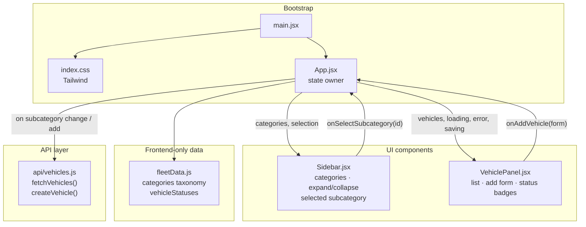
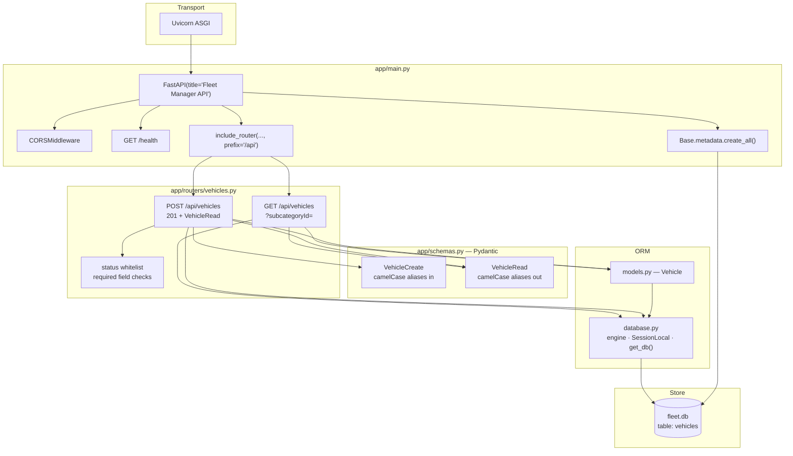
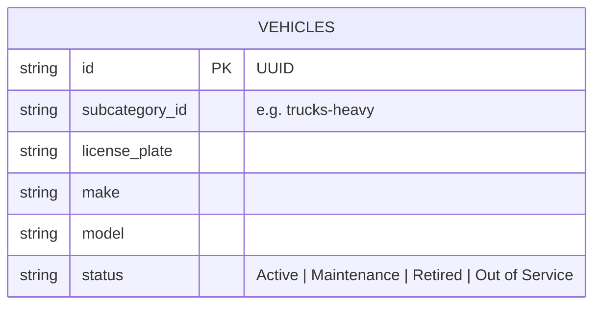
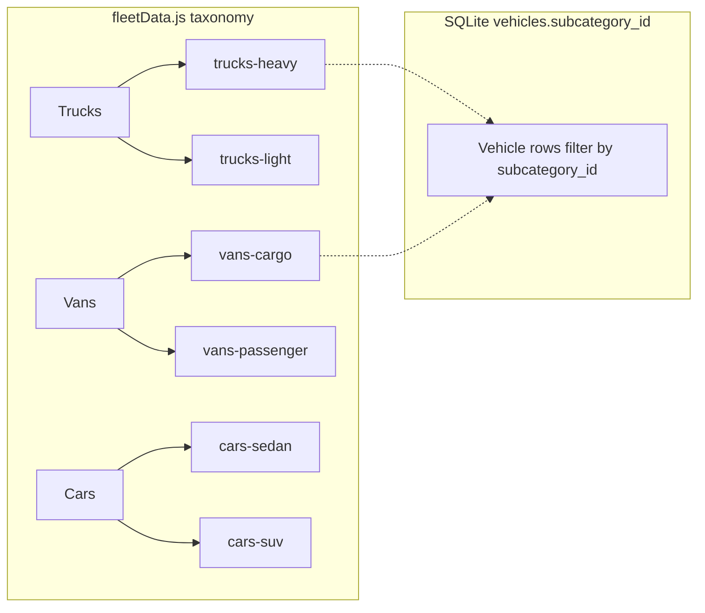
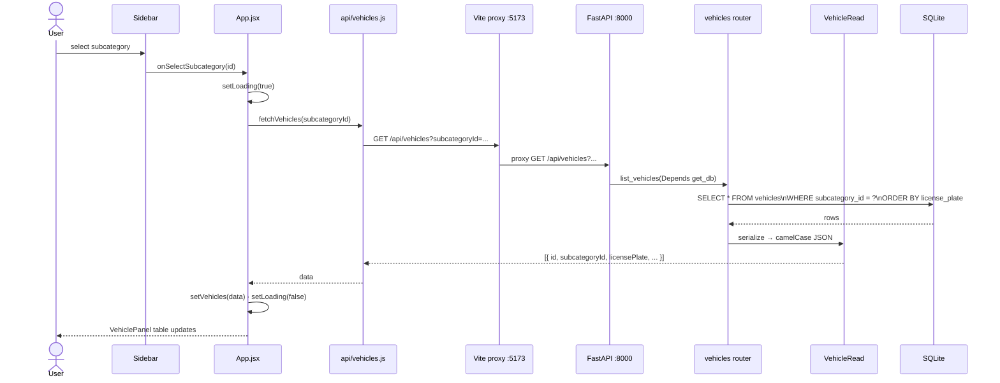
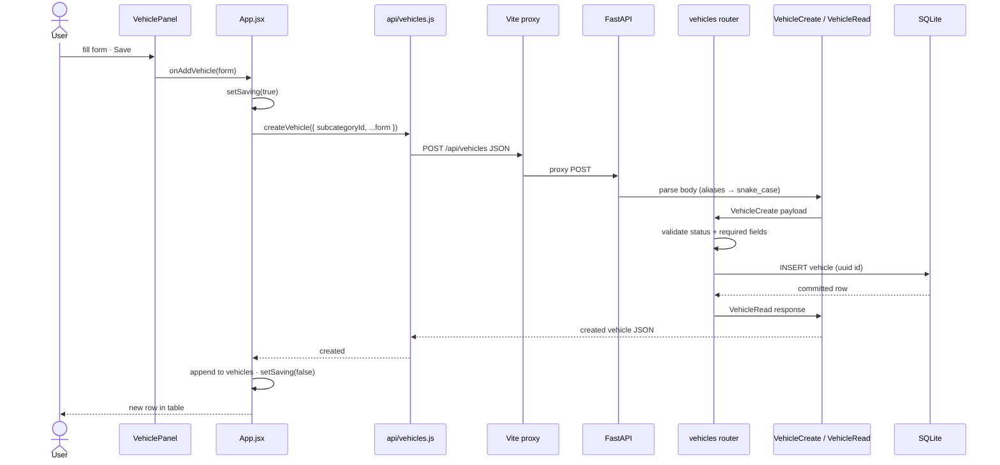
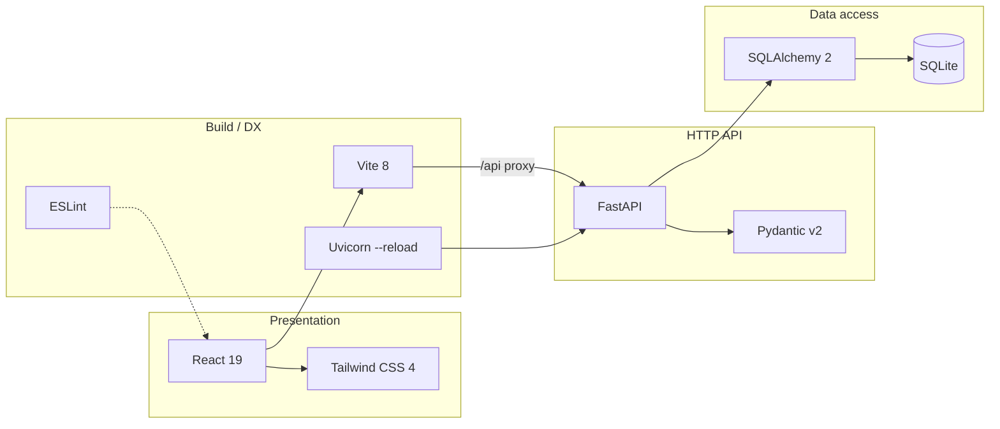

# Fleet App

A full-stack fleet management app for browsing vehicle categories and managing vehicles (list + create) by subcategory.

## Tech stack

| Layer | Technologies |
| --- | --- |
| Frontend | React 19, Vite 8, Tailwind CSS 4 |
| Backend | FastAPI, Uvicorn, Pydantic |
| Data | SQLAlchemy 2, SQLite |
| Tooling | ESLint, Python `venv` |

## Architecture

### 1. System overview (runtime)

How the pieces talk to each other while developing locally.


### 2. Frontend component & state architecture



**State held in `App.jsx`:**

| State | Role |
| --- | --- |
| `selectedSubcategoryId` | Drives which vehicles to load |
| `vehicles` | Current list from the API |
| `loading` / `error` / `saving` | UX for fetch and create |

Categories stay in `fleetData.js` (static). Vehicles live in SQLite via the API.

### 3. Backend layered architecture



### 4. Data model

Categories exist only on the frontend. The database stores vehicles keyed by `subcategory_id`.





### 5. Sequence: list vehicles



### 6. Sequence: create vehicle



### 7. Tech map by concern



## Features

- Browse vehicle categories and subcategories (trucks, vans, cars)
- List vehicles filtered by subcategory
- Add a vehicle with license plate, make, model, and status
- Statuses: `Active`, `Maintenance`, `Retired`, `Out of Service`

## Project structure

```text
fleet-app/
├── frontend/                 # React + Vite UI
│   ├── src/
│   │   ├── api/vehicles.js   # API client
│   │   ├── components/       # Sidebar, VehiclePanel
│   │   ├── data/fleetData.js # Category taxonomy
│   │   └── App.jsx
│   └── vite.config.js        # Proxies /api → :8000
└── backend/                  # FastAPI API
    ├── app/
    │   ├── main.py           # App entry, CORS, routers
    │   ├── database.py       # SQLite + session
    │   ├── models.py         # SQLAlchemy Vehicle
    │   ├── schemas.py        # Pydantic request/response
    │   └── routers/vehicles.py
    ├── data/fleet.db         # Local SQLite DB (gitignored)
    ├── seed.py               # Optional sample data
    └── requirements.txt
```

## Getting started

### Prerequisites

- Node.js 20+
- Python 3.11+

### Backend

```bash
cd backend
python3 -m venv .venv
source .venv/bin/activate
pip install -r requirements.txt
uvicorn app.main:app --reload --port 8000
```

Optional seed data:

```bash
cd backend
source .venv/bin/activate
python seed.py
```

API docs: [http://localhost:8000/docs](http://localhost:8000/docs)  
Health check: [http://localhost:8000/health](http://localhost:8000/health)

### Frontend

```bash
cd frontend
npm install
npm run dev
```

App: [http://localhost:5173](http://localhost:5173)

Vite proxies `/api` requests to the backend on port `8000`.

## API overview

| Method | Path | Description |
| --- | --- | --- |
| `GET` | `/health` | Health check |
| `GET` | `/api/vehicles?subcategoryId=` | List vehicles (optional filter) |
| `POST` | `/api/vehicles` | Create a vehicle |

Example create body:

```json
{
  "subcategoryId": "trucks-heavy",
  "licensePlate": "TX-4821",
  "make": "Ford",
  "model": "F-350",
  "status": "Active"
}
```
