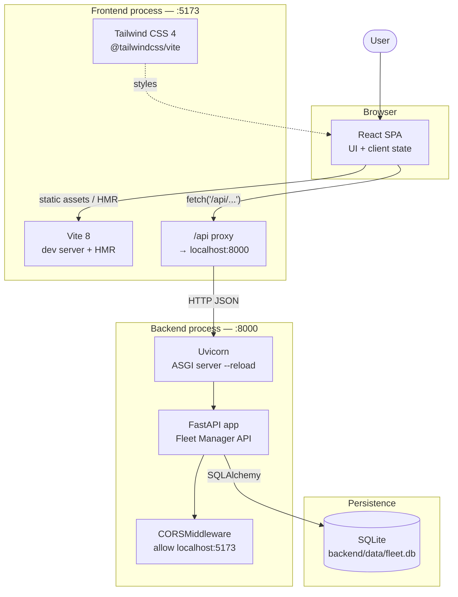
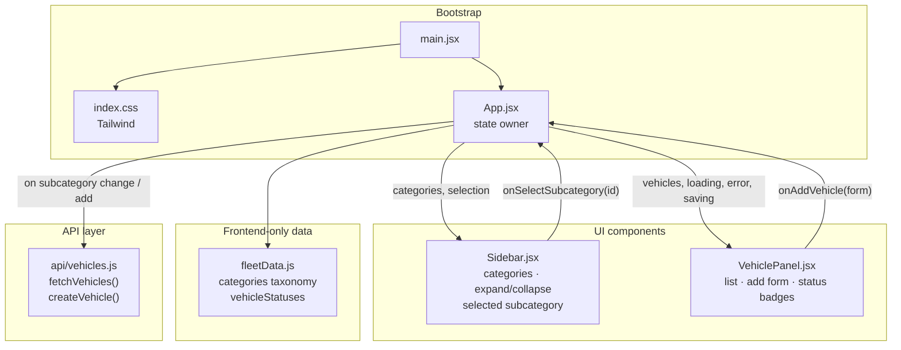
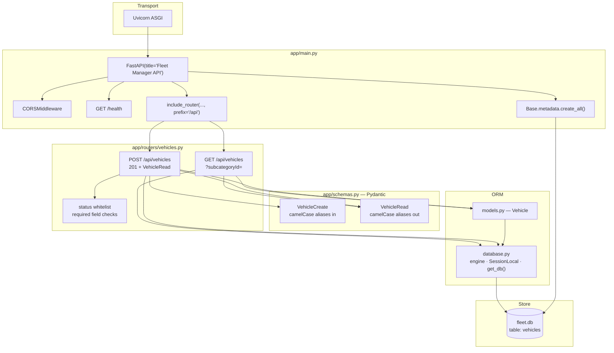
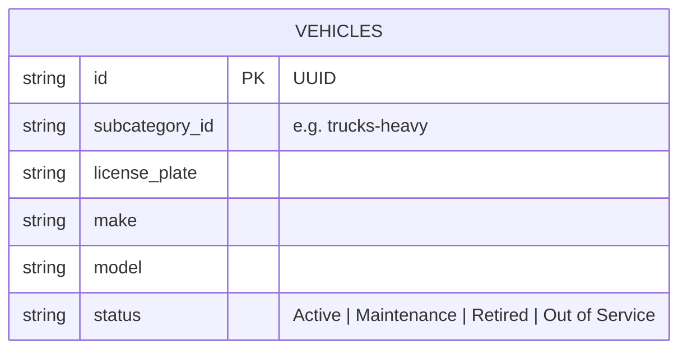
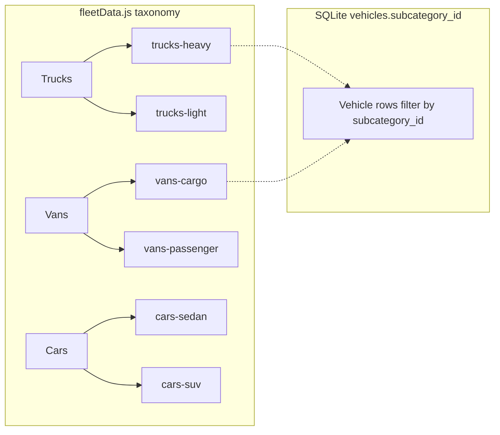
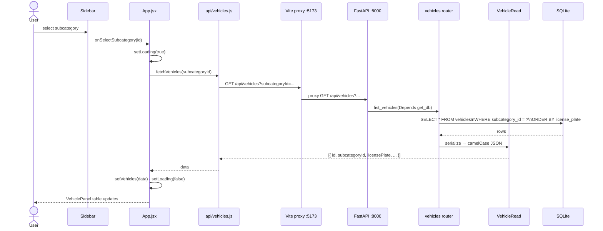
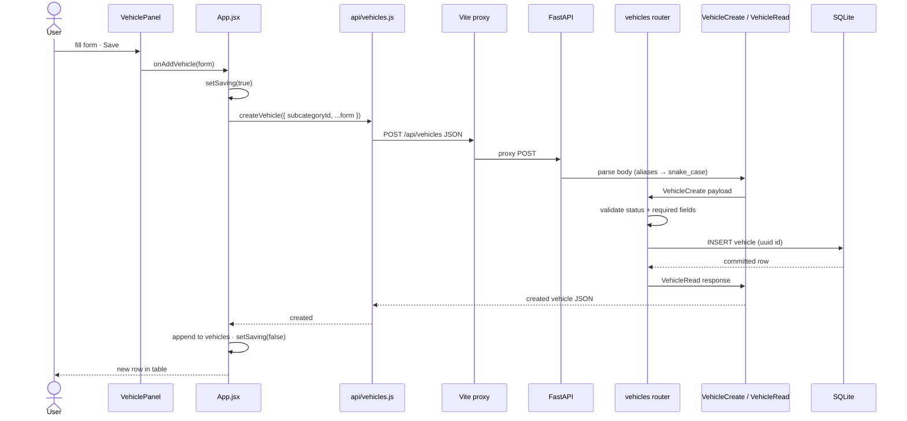
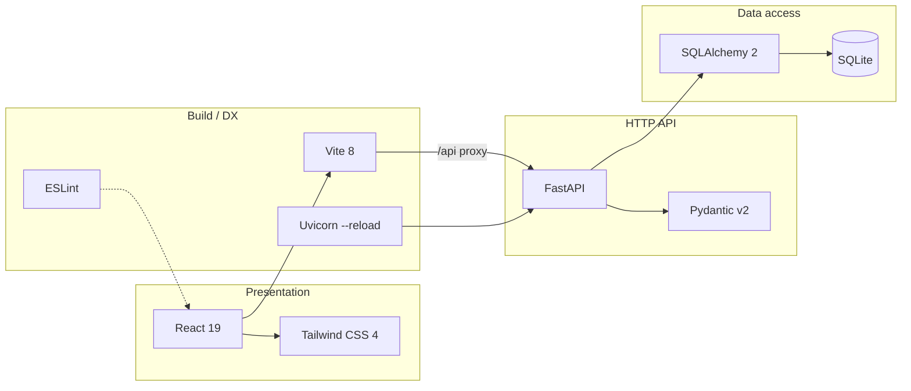
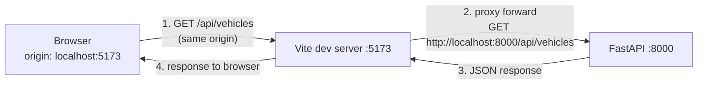
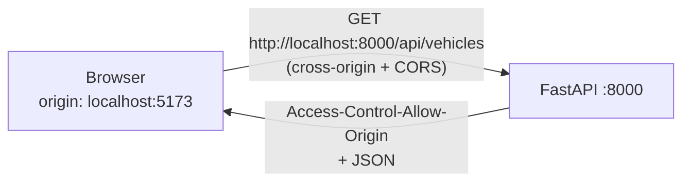

# Fleet App

## Features

- Browse vehicle categories and subcategories (trucks, vans, cars)
- List vehicles filtered by subcategory
- Add a vehicle with license plate, make, model, and status
- Statuses: `Active`, `Maintenance`, `Retired`, `Out of Service`

## Overview

Fleet App is a small full-stack fleet manager. On the left you pick a vehicle subcategory (for example Heavy Duty trucks or Cargo vans); on the right you see the vehicles in that group and can add new ones with a license plate, make, model, and status. Category labels live in the React frontend; vehicle records are stored in SQLite and served by a FastAPI backend.

## Tech stack

| Layer | Technologies |
| --- | --- |
| Frontend | React 19, Vite 8, Tailwind CSS 4 |
| Backend | FastAPI, Uvicorn, Pydantic |
| Data | SQLAlchemy 2, SQLite |
| Tooling | ESLint, Python `venv` |

## Architecture

### 1. System overview (runtime)

How the pieces talk to each other while developing locally.



### 2. Frontend component & state architecture



**State held in `App.jsx`:**

| State | Role |
| --- | --- |
| `selectedSubcategoryId` | Drives which vehicles to load |
| `vehicles` | Current list from the API |
| `loading` / `error` / `saving` | UX for fetch and create |

Categories stay in `fleetData.js` (static). Vehicles live in SQLite via the API.

### 3. Backend layered architecture



### 4. Data model

Categories exist only on the frontend. The database stores vehicles keyed by `subcategory_id`.





### 5. Sequence: list vehicles



### 6. Sequence: create vehicle



### 7. Tech map by concern



## Vite proxy (development)

During local development the React app runs on **port 5173** and the FastAPI API on **port 8000**. Browsers treat those as different origins. This project uses Vite’s **dev-server proxy** so the frontend can call the API with same-origin relative URLs (`/api/...`) while Vite forwards those requests to the backend.

### How it is configured

**1. Vite proxy** — `frontend/vite.config.js`:

```js
export default defineConfig({
  plugins: [react(), tailwindcss()],
  server: {
    proxy: {
      '/api': 'http://localhost:8000',
    },
  },
})
```

Any request from the browser to `http://localhost:5173/api/...` is forwarded by the Vite process to `http://localhost:8000/api/...`. The path is preserved; only the host/port change.

**2. API client default base URL** — `frontend/src/api/vehicles.js`:

```js
const API_BASE = import.meta.env.VITE_API_URL ?? '/api'
```

With no env override, calls look like `fetch('/api/vehicles')`. That hits the Vite origin, so the proxy applies. Paths after `/api` (for example `/vehicles`) are appended by the client helpers.

**3. Backend routes** — FastAPI mounts the vehicles router under `/api`:

```python
app.include_router(vehicles.router, prefix="/api")
# → GET/POST /api/vehicles
```

So the path the browser uses (`/api/vehicles`) matches the path FastAPI serves after the proxy rewrite.



### Why this helps in development

| Benefit | What it means in practice |
| --- | --- |
| Avoids CORS for day-to-day UI work | The browser only talks to `:5173`. Cross-origin checks do not apply to the proxied hop (Vite → FastAPI is server-to-server). |
| Simple relative URLs | The client uses `/api` instead of hard-coding `http://localhost:8000` in every call. |
| Matches a common production shape | Many deployments serve the SPA and API under one public origin (or a gateway). Relative `/api` paths stay valid when you later put a reverse proxy in front. |
| One mental model while coding | Open the app at `:5173`; API traffic still goes through that origin. Backend stays on `:8000` for docs (`/docs`) and direct testing. |
| Easy to override later | `VITE_API_URL` can point somewhere else without changing call sites. |

**Note:** CORS is still configured on FastAPI (`allow_origins=["http://localhost:5173"]`) so direct browser calls to `:8000` (or a no-proxy setup below) can work. With the proxy, that CORS policy is usually unused for the SPA’s `/api` fetches.

### Running without the Vite proxy

Use this when you want the browser to call FastAPI **directly** (different origin), for example to debug CORS, hit a remote API, or drop the proxy entirely.

**1. Point the API client at the backend**

Create `frontend/.env.local` (gitignored if you add `.env*` patterns; otherwise keep secrets out of commits):

```bash
# frontend/.env.local
VITE_API_URL=http://localhost:8000/api
```

Restart `npm run dev` after changing env files. Vite only reads `VITE_*` vars at startup.

The client already supports this via:

```js
const API_BASE = import.meta.env.VITE_API_URL ?? '/api'
```

Requests become `http://localhost:8000/api/vehicles` instead of `/api/vehicles`.

**2. Keep backend CORS aligned with the UI origin**

In `backend/app/main.py`, `CORSMiddleware` must allow the frontend origin:

```python
app.add_middleware(
    CORSMiddleware,
    allow_origins=["http://localhost:5173"],
    allow_credentials=True,
    allow_methods=["*"],
    allow_headers=["*"],
)
```

If the UI is served from another host/port, add that origin to `allow_origins` (or temporarily use a broader list only for local debugging).

**3. Optionally remove or disable the Vite proxy**

In `frontend/vite.config.js`, delete the `server.proxy` block (or leave it; unused if the client never calls `/api` on `:5173`):

```js
export default defineConfig({
  plugins: [react(), tailwindcss()],
  // no server.proxy — browser talks to FastAPI directly
})
```

**4. Checklist**

| Step | Action |
| --- | --- |
| Env | Set `VITE_API_URL=http://localhost:8000/api` |
| Restart | Restart Vite after env changes |
| CORS | Ensure FastAPI allows `http://localhost:5173` |
| Proxy | Optional: remove `server.proxy` from `vite.config.js` |
| Verify | Network tab should show requests to `:8000`, not only `:5173/api` |



**Production note:** Prefer a reverse proxy (nginx, Caddy, cloud gateway) or same-origin hosting instead of exposing `localhost` URLs. Set `VITE_API_URL` (or bake the public API base at build time) to your real API origin when you are not serving `/api` from the same host as the SPA.

## Project structure

```text
fleet-app/
├── frontend/                 # React + Vite UI
│   ├── src/
│   │   ├── api/vehicles.js   # API client
│   │   ├── components/       # Sidebar, VehiclePanel
│   │   ├── data/fleetData.js # Category taxonomy
│   │   └── App.jsx
│   └── vite.config.js        # Proxies /api → :8000
└── backend/                  # FastAPI API
    ├── app/
    │   ├── main.py           # App entry, CORS, routers
    │   ├── database.py       # SQLite + session
    │   ├── models.py         # SQLAlchemy Vehicle
    │   ├── schemas.py        # Pydantic request/response
    │   └── routers/vehicles.py
    ├── data/fleet.db         # Local SQLite DB (gitignored)
    ├── seed.py               # Optional sample data
    └── requirements.txt
```

## Getting started

### Prerequisites

- Node.js 20+
- Python 3.11+

### Backend

```bash
cd backend
python3 -m venv .venv
source .venv/bin/activate
pip install -r requirements.txt
uvicorn app.main:app --reload --port 8000
```

Optional seed data:

```bash
cd backend
source .venv/bin/activate
python seed.py
```

API docs: [http://localhost:8000/docs](http://localhost:8000/docs)  
Health check: [http://localhost:8000/health](http://localhost:8000/health)

### Frontend

```bash
cd frontend
npm install
npm run dev
```

App: [http://localhost:5173](http://localhost:5173)

By default, Vite proxies `/api` to the backend on port `8000`. See [Vite proxy (development)](#vite-proxy-development) for how that works, why it helps, and how to call the API directly without the proxy.

## API overview

| Method | Path | Description |
| --- | --- | --- |
| `GET` | `/health` | Health check |
| `GET` | `/api/vehicles?subcategoryId=` | List vehicles (optional filter) |
| `POST` | `/api/vehicles` | Create a vehicle |

Example create body:

```json
{
  "subcategoryId": "trucks-heavy",
  "licensePlate": "TX-4821",
  "make": "Ford",
  "model": "F-350",
  "status": "Active"
}
```
